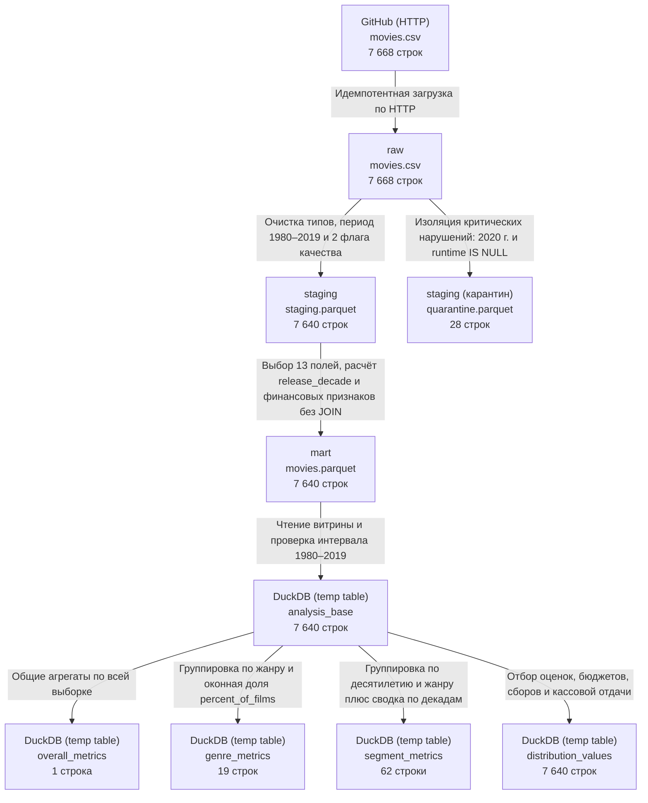

# Маршрут данных Movie Industry

## 1. Контекст анализа

### Вопрос

Как в период четырёх полных десятилетий с 1980 по 2019 год различаются число фильмов в выборке (`films_count`), медианный коэффициент кассовой отдачи (`gross / budget`), доля кассово окупившихся релизов (`gross >= budget`) и медианная оценка IMDb (`score`) между основными жанрами (`genre`) и как уточняется картина при разбивке по четырём полным десятилетиям выпуска (`release_decade`)?

### Выбранное значение метрики

Для разбора выбрана доля кассово окупившихся релизов (`recoup_rate_pct`) для основного жанра **`Action`** за четыре полных десятилетия **`1980–2019` гг.** — **`72,64 %`** (единица измерения — проценты `%`; точное отношение `100.0 * 1025 / 1411`).

Всего в выборке за `1980–2019` гг. содержится **`7 640` фильмов** (с ограничением исходного датасета до `200` наиболее популярных фильмов на каждый год), из них **`5 427`** имеют полную положительную финансовую пару. В срезе `genre = 'Action'` представлено **`1 697` записей** (`films_count`), из которых в расчёт доли окупаемости вошли **`1 411` фильмов** с полной финансовой парой (`complete_fin_count`), а условие `gross_usd >= budget_usd` выполнилось для **`1 025` картин** (`recouped_count`). Остальные `286` фильмов жанра `Action` без полного бюджета или сборов исключены из расчёта доли, но учтены в `films_count` (`1 697`), оконной доле `percent_of_films` (`22,212 %`) и медианной оценке `median_imdb_score` (`6,2`).

### Исходные данные

Использован публичный статический набор *Movie Industry* (составитель Daniel Grijalva, выгрузка публичных карточек фильмов IMDb, лицензия `CC0-1.0`), опубликованный в репозитории https://github.com/danielgrijalva/movie-stats (прямая ссылка на исходный CSV-файл: https://raw.githubusercontent.com/danielgrijalva/movie-stats/master/movies.csv; локальный резервный снимок — [`data/source/movies.csv`](../data/source/movies.csv)). Файл загружен по HTTP в слой `raw` хранилища SeaweedFS DAG-ом [`airflow/dags/ingest_raw.py`](../airflow/dags/ingest_raw.py) через [`src/ingestion/load_raw.py`](../src/ingestion/load_raw.py).

| Исходные данные | Путь в `raw` | Объём снимка |
|---|---|---|
| Каталог фильмов *Movie Industry* | `s3://raw/movie_industry/ingested_on=2026-10-24/movies.csv` | `7 668` строк, `15` полей, `1 344 929` байт |

---

## 2. Схема происхождения данных (data lineage)

| Переход | Реализация и существующие проверки |
|---|---|
| HTTP-источник --> `raw` | Идемпотентная загрузка выполняется DAG-ом [`airflow/dags/ingest_raw.py`](../airflow/dags/ingest_raw.py) и модулем [`src/ingestion/load_raw.py`](../src/ingestion/load_raw.py) с фиксацией даты снимка `ingested_on=2026-10-24`. Чтение `raw` через DuckDB и параметры S3 проверяются в [`src/analysis/read_raw.py`](../src/analysis/read_raw.py) и [`scripts/read_raw.py`](../scripts/read_raw.py) (`7 668` строк). |
| `raw` --> `staging` и `quarantine` | Правила качества применяются в [`notebooks/profile_quality.ipynb`](../notebooks/profile_quality.ipynb) (`raw_movies` -> `evaluated_movies` -> `staging_prepared` / `quarantine_prepared`) и описаны в [`docs/data_quality_report.md`](data_quality_report.md). Проверяется уникальность составного ключа `(lower(trim(name)), year)` (`0` дубликатов) и 6 правил качества: `28` строк с критическими нарушениями (`25` фильмов `2020` года, включая `3` без `score`/`votes` и `1` без `runtime`, плюс `3` фильма `2010–2012` гг. с `runtime IS NULL`) уходят в `quarantine.parquet`; `7 640` строк `1980–2019` гг. сохраняются в `staging.parquet` с булевыми флагами `quality_incomplete_financials` (`2 213` строк) и `quality_nonstandard_rating` (`419` строк). Сверка на `saved_staging` и `saved_quarantine` из S3 подтверждает баланс `7 668 = 7 640 + 28`, `0` критических нарушений в `staging`, `0` расхождений флагов и неизменность `raw` (`1 344 929` байт). |
| `staging` --> `mart` | В [`notebooks/build_mart.ipynb`](../notebooks/build_mart.ipynb) (`staging_movies` -> `movies_prepared` -> `published_movies`) строится одна широкая витрина `movies` (`13` полей) без отдельных таблиц измерений и без `JOIN`, с сортировкой `ORDER BY s.year, lower(s.name)` и описанием модели в [`docs/mart.md`](mart.md). На прочитанном из S3 в отдельном соединении файле `movies.parquet` (`191 863` байт) пройдены все `44 из 44` проверок: сохранены все `7 640` строк (`0` исключённых), подтверждена уникальность ключа `(lower(movie_title), release_year)`, диапазоны мер и `0` расхождений при сверке `EXCEPT ALL`. |
| `mart` --> `analysis_base` --> результаты ЛР № 5 | В [`notebooks/calculate_metrics.ipynb`](../notebooks/calculate_metrics.ipynb) ячейка `M03` читает `movies.parquet` через представление `movies_mart` и создаёт временную таблицу `analysis_base` (`7 640` строк за `1980–2019` гг.). Ячейка `M04` рассчитывает `overall_metrics` (`1` строка), `M05` — `genre_metrics` (`19` строк, `genre_raw`), `M06` — `segment_metrics` (`62` строки, `segment_rows`, плюс сводку `decade_totals` из `4` строк) и `distribution_values` (`7 640` строк, а также списки `imdb_scores`, `return_ratios` и `paired_fin_scores`). Ячейка `M07` подтверждает `7 из 7` проверок сходимости сумм (`7 640` фильмов, `5 427` финансовых пар), оконной суммы (`100,00 %`) и общей доли окупаемости (`67,75 %`). |

| Набор данных | Путь в SeaweedFS (S3) |
|---|---|
| `raw` | `s3://raw/movie_industry/ingested_on=2026-10-24/movies.csv` |
| `staging` | `s3://staging/movie_industry/source_ingested_on=2026-10-24/staging.parquet` |
| `quarantine` | `s3://staging/movie_industry/source_ingested_on=2026-10-24/quarantine.parquet` |
| `mart` | `s3://mart/movie_industry/source_ingested_on=2026-10-24/movies.parquet` |

---

## 3. Маршрут данных для выбранного значения метрики

От показанного результата **`72,64 %`** для жанра `Action` маршрут проходит обратно через расчёт метрики, витрину и слой `staging` до исходного CSV-файла в `raw`:

1. **Вывод результата и SQL-расчёт в [`notebooks/calculate_metrics.ipynb`](../notebooks/calculate_metrics.ipynb) (ячейка `M05`, `m05-genre`):** в HTML-таблице вывода `genre_rows` значение `72.64` находится в строке `genre = 'Action'`, столбец `recoup_rate_pct` (рядом указаны `films_count = 1697`, `complete_fin_count = 1411`, `recouped_count = 1025`). Запрос формирует временную таблицу `genre_metrics`, группируя строки временной таблицы `analysis_base` по полю `genre` (`GROUP BY genre`), и вычисляет долю окупаемости в CTE `grouped` по формуле:
   `100.0 * count(*) FILTER (WHERE is_gross_ge_budget) / nullif(count(*) FILTER (WHERE NOT incomplete_financials_flag), 0) AS recoup_rate_pct` с последующим округлением `round(recoup_rate_pct, 2)` при выводе.

   Одна строка `analysis_base` соответствует одному полнометражному фильму периода `1980–2019` гг. с ключом `(lower(movie_title), release_year)`. В группу `Action` входят все `1 697` фильмов этого жанра, однако оговорка `FILTER (WHERE ...)` ограничивает расчёт `recoup_rate_pct`: в знаменатель `complete_fin_count` попадают `1 411` фильмов с `incomplete_financials_flag = false`, а в числитель `recouped_count` — `1 025` фильмов с `is_gross_ge_budget = true`. Оставшиеся `286` фильмов жанра `Action` с неполными финансами имеют `is_gross_ge_budget IS NULL` и `incomplete_financials_flag = true`, поэтому не участвуют ни в числителе, ни в знаменателе доли, но сохраняются в `films_count` (`1 697`), оконной доле `percent_of_films` (`22,212 %`) и `median_imdb_score` (`6,2`).

2. **Отбор входной выборки и сборка витрины:** в ячейке `M03` (`m03-input`) ноутбука `calculate_metrics.ipynb` временная таблица `analysis_base` читает объект `s3://mart/movie_industry/source_ingested_on=2026-10-24/movies.parquet` (`hive_partitioning = false`) и отбирает период `WHERE release_year BETWEEN 1980 AND 2019` (все `7 640` строк витрины).

   Сама витрина `movies.parquet` формируется в ячейке `step3-build` ноутбука [`notebooks/build_mart.ipynb`](../notebooks/build_mart.ipynb) (временная таблица `movies_prepared`) напрямую из `staging.parquet` без `JOIN` и без исключения строк. Ключевые поля витрины связаны с полями `staging` следующими преобразованиями (включая ветвление одного исходного поля в несколько атрибутов витрины):
   - из `s.genre` переносится поле группировки `genre`;
   - из одного поля `s.year` получаются сразу два поля витрины — `release_year` (отбор `1980–2019` и второй компонент ключа) и `release_decade` (`concat((s.year // 10) * 10, '-', (s.year // 10) * 10 + 9)`, группировка в `M06`);
   - пара полей `s.budget` и `s.gross` через флаг `s.quality_incomplete_financials` порождает сразу пять полей витрины: `budget_usd`, `gross_usd`, `incomplete_financials_flag` (прямое переименование флага из `staging`), производное отношение `gross_to_budget_ratio` и булев признак окупаемости `is_gross_ge_budget` (`CASE WHEN NOT s.quality_incomplete_financials THEN s.gross >= s.budget ELSE NULL END`).

3. **Подготовка `staging` и связь с `raw`:** в [`notebooks/profile_quality.ipynb`](../notebooks/profile_quality.ipynb) (`step4-transform`, представления `raw_movies`, `evaluated_movies`, `staging_prepared`) поля `genre`, `year`, `budget`, `gross` поступают из `s3://raw/movie_industry/ingested_on=2026-10-24/movies.csv` (`7 668` строк). Строковые значения `genre` очищаются через `NULLIF(trim(genre), '')`, `year` приводится к `INTEGER`, а `budget` и `gross` — к `DOUBLE`.

   В исходном файле `movies.csv` числится `1 705` фильмов жанра `Action`, из которых в `staging.parquet` попадают `1 697`. Разницу в `8` записей составляет карантин критических нарушений: `7` фильмов `2020` года по правилу `year_in_study_period` (*Tenet*, *Wonder Woman 1984*, *Birds of Prey*, *Bad Boys for Life*, *Sonic the Hedgehog*, *The Eight Hundred* и *The Robinsons*, у которого также отсутствуют `score` и `votes`) и `1` фильм `2012` года без хронометража по правилу `positive_runtime` (*One for the Money*). Для дошедших до `staging` `1 697` боевиков правило `complete_positive_financials` (`budget IS NULL OR budget <= 0 OR gross IS NULL OR gross <= 0`) выставляет `quality_incomplete_financials = true` у `286` записей и `false` у `1 411` записей с полной положительной финансовой парой.

### Словарь ключевых полей

| Поле витрины | Смысл, тип и единица измерения | Источник, преобразование и роль в расчёте |
|---|---|---|
| `is_gross_ge_budget` | Признак покрытия бюджета валовой кассой (`gross_usd >= budget_usd`), `BOOLEAN`, логическое | Вычисляется в `build_mart.ipynb` из пары `budget`, `gross` слоя `raw` (через `staging`) и флага `quality_incomplete_financials`: при полной паре `s.gross >= s.budget`, иначе `NULL`. Формирует числитель `recouped_count` (`FILTER (WHERE is_gross_ge_budget)`) при расчёте `recoup_rate_pct`. |
| `incomplete_financials_flag` | Флаг отсутствия полной положительной финансовой пары, `BOOLEAN`, логическое | Вычисляется в `profile_quality.ipynb` правилом `complete_positive_financials` над исходными полями `budget` и `gross` (`budget IS NULL OR budget <= 0 OR gross IS NULL OR gross <= 0`) и переносится из `staging.quality_incomplete_financials`. Задаёт знаменатель `complete_fin_count` (`FILTER (WHERE NOT incomplete_financials_flag)`). |
| `genre` | Основной жанр карточки IMDb, `VARCHAR`, строка категории | Одноимённое поле исходного файла `movies.csv` (`19` категорий, в `staging` очищается `NULLIF(trim(genre), '')` и переносится в витрину без перекодировки). Задаёт группировку `GROUP BY genre` в `M05` и выделяет срез `Action`. |
| `release_year` | Календарный год выхода фильма, `INTEGER`, год (`1980–2019`) | Поле `year` из `raw` приводится к `INTEGER`, отбирается правилом периода `1980–2019` в `staging` и переименовывается в `release_year` (из того же `year` в витрине дополнительно строится `release_decade`). В `M03` задаёт отбор отчётного периода `WHERE release_year BETWEEN 1980 AND 2019` и входит в ключ фильма. |
| `budget_usd` | Производственный бюджет фильма, `DOUBLE`, номинальные USD | Поле `budget` из `raw` приводится к `DOUBLE` в `staging` и переименовывается в `budget_usd` в витрине (`2 159` допустимых `NULL` по витрине). Участвует в определении флага `incomplete_financials_flag` и правом операнде сравнения для `is_gross_ge_budget`. |
| `gross_usd` | Мировые валовые кассовые сборы, `DOUBLE`, номинальные USD | Поле `gross` из `raw` приводится к `DOUBLE` в `staging` и переименовывается в `gross_usd` в витрине (`177` допустимых `NULL` по витрине). Участвует в определении флага `incomplete_financials_flag` и левом операнде сравнения для `is_gross_ge_budget`. |

Полный маппинг всех `13` физических полей витрины `movies` приведён в [`docs/mart.md`](mart.md), а определения остальных метрик — в [`docs/metrics.md`](metrics.md).

---

## 4. Влияние изменения порога окупаемости при сборке витрины

Рассмотрим сценарий, в котором критерий кассовой окупаемости при сборке витрины ужесточается с простого покрытия производственного бюджета (`s.gross >= s.budget`) до двукратного превышения валовых сборов над бюджетом (`s.gross >= 2.0 * s.budget`) — например, чтобы условно учесть затраты на маркетинг и долю кинотеатральных сетей.

- **Где возникнет изменение:** модификация затронет SQL-выражение расчёта поля `is_gross_ge_budget` в ячейке `step3-build` ноутбука [`notebooks/build_mart.ipynb`](../notebooks/build_mart.ipynb) (временная таблица `movies_prepared`) и пересобранный файл `s3://mart/movie_industry/source_ingested_on=2026-10-24/movies.parquet`. Исходный снимок в `raw`, а также `staging.parquet` и `quarantine.parquet` не изменяются, так как правило `complete_positive_financials` и переносимые поля `budget` и `gross` остаются прежними.
- **Какие данные и поля затронет:** в витрине `movies.parquet` и читаемой из неё временной таблице `analysis_base` (`M03`) изменится только логическое значение `is_gross_ge_budget` у фильмов с полной финансовой парой (`NOT incomplete_financials_flag`), у которых коэффициент кассовой отдачи лежит в интервале `1,0 <= gross_to_budget_ratio < 2,0` (`true` сменится на `false`). Общее число строк (`7 640`), флаг `incomplete_financials_flag`, число полных финансовых пар `complete_fin_count` (`5 427` по выборке и `1 411` по `Action`) и индивидуальные отношения `gross_to_budget_ratio` останутся без изменений.
- **Какие метрики и результаты ЛР № 5 изменятся:** в [`notebooks/calculate_metrics.ipynb`](../notebooks/calculate_metrics.ipynb) через выражение `count(*) FILTER (WHERE is_gross_ge_budget)` уменьшатся показатели `recouped_count` и `recoup_rate_pct` сразу в трёх итоговых таблицах — `overall_metrics` (`M04`), `genre_metrics` (`M05`) и `segment_metrics` (`M06`, включая сводку по десятилетиям `decade_totals`). Одновременно число фильмов в выборке `films_count`, оконная доля `percent_of_films`, медианный коэффициент отдачи `median_return_ratio`, медианная оценка `median_imdb_score` и таблица индивидуальных значений `distribution_values` (`M06`) не изменятся, поскольку поле `is_gross_ge_budget` в них не используется.
- **Влияние на выбранное значение (`72,64 %` для `Action`):** выбранное значение **снизится**. В срезе `genre = 'Action'` знаменатель `complete_fin_count` останется прежним (`1 411`), а из числителя `recouped_count` (`1 025`) выбывают `359` фильмов с отдачей от `1,0` до `2,0` раза — в результате доля кассово окупившихся фильмов жанра `Action` опустится с `72,64 %` (`1 025 / 1 411`) до `47,20 %` (`666 / 1 411`).
